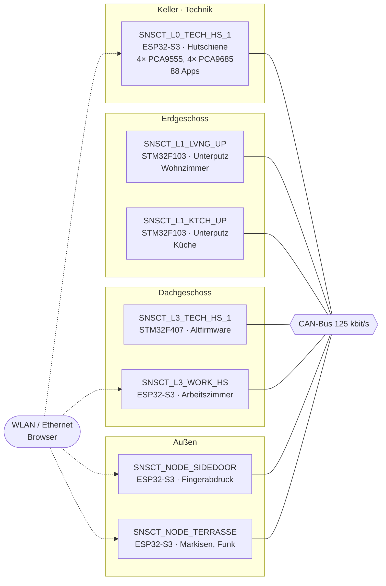
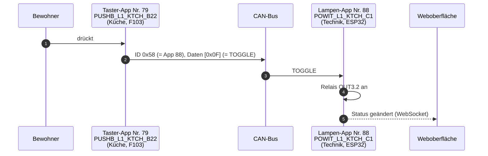
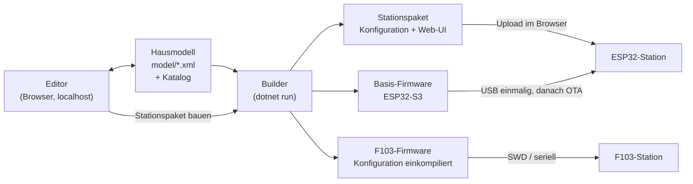

# 1 Systemüberblick

## Die Idee in drei Sätzen

1. **Das Haus ist ein Netz gleichberechtigter Stationen** an einem CAN-Bus. Es gibt keine
   Zentrale, deren Ausfall das Haus lahmlegt: Ein Taster im Wohnzimmer schaltet die Lampe in der
   Technikstation direkt über den Bus.
2. **Die kleinste Einheit ist die App.** Jeder Taster, jede Lampe, jeder Rollladen ist eine App mit
   einer im ganzen Haus eindeutigen, nie wechselnden Nummer. Apps schicken einander Kommandos –
   egal, ob die Ziel-App auf derselben Station läuft oder auf einer anderen.
3. **Ein Modell, viele Erzeugnisse.** Das XML-Hausmodell beschreibt alles: Stationen, Hardware,
   Apps und ihre Verknüpfungen. Daraus erzeugt der Builder die Konfiguration jeder Station und
   ihre Weboberfläche. Die Firmware selbst ist (auf den ESP32-Stationen) für alle gleich.

## Das Haus als Netz

Die Stationen des Modells `Sattlerstrasse16`, rund 190 Apps. Die ESP32-Stationen haben zusätzlich
WLAN bzw. Ethernet und eine eigene Weboberfläche; die STM32-Stationen hängen nur am CAN-Bus.

Typische Rollenverteilung:

- **Technikstationen** (Hutschiene im Verteiler) tragen die Leistung: Relais, PWM-Dimmer, Rollladenmotoren,
  Netzteile, Pumpe, Klingelton. An ihnen hängen auch die Taster der Räume über lange Leitungen und
  I2C-Erweiterungen.
- **Unterputzstationen** sitzen im Raum: Taster, Drehgeber, Signal-LEDs, ggf. eigene Dimmerausgänge.
- **Spezialstationen** binden Besonderes an: Fingerabdruckleser an der Seitentür, Funkfernbedienung
  und Markisen auf der Terrasse.

## Vom Tastendruck zum Licht

Die Taster-App weiß nur, **welche Ziel-Apps** sie hat und **welches Kommando** sie schickt. Wo die
Ziel-App läuft, entscheidet der App-Host der Station: lokal → direkter Aufruf, sonst → CAN-Nachricht.
Details: [Apps](03-apps.md), [Kommunikation](04-kommunikation.md).

## Die Werkzeugkette

- **Hausmodell ändern** (Taster umbelegen, Zeit ändern, App ergänzen): Editor → Stationspaket bauen →
  im Browser hochladen. Keine neue Firmware.
- **Basis-Firmware ändern** (neuer App-Typ, Fehlerbehebung): Firmware bauen, per OTA hochladen, dazu
  passende Pakete.
- **F103-Stationen**: Konfiguration steckt im Firmware-Image; jede Änderung heißt neu bauen und flashen
  (Übertragung über CAN ist als Konzept beschrieben).

Mehr in [Konfiguration und Auslieferung](06-konfiguration-und-auslieferung.md).

## Leitlinien des Entwurfs

| Leitlinie | Warum | Folge |
|---|---|---|
| Verteilt statt zentral | Ausfall einer Station darf nur ihre eigenen Apps betreffen | Taster → Lampe über den Bus, ohne Server |
| Nummern sind ewig | Nummern stehen in Konfigurationen anderer Stationen und auf dem Bus | gelöschte Apps bleiben als `<reserved>` stehen |
| Eine App-Implementierung | dieselben Apps auf ESP32 und STM32F103, eine Testsuite | Apps hängen nur am Interface `iSensactContext` |
| Modell lesbar und versionierbar | Änderungen sollen im Git-Diff verständlich sein | XML mit XSD; Binärformat nur auf dem Gerät |
| Ein Fehler darf das Gerät nicht unbedienbar machen | Stationen sitzen in Wänden und Verteilern | Sicherheitsmodus mit eingebauter Wartungsseite, Watchdogs, Prüfsummen |
| Prüfen vor dem Ausliefern | Fehler im Modell sollen am Schreibtisch auffallen, nicht im Flur | Schema-, Katalog- und Kommandoprüfung in Editor und Builder |

## Repositories

Der Code liegt im Repo `sensact` (Firmware, Apps, Hausmodell, Builder, Editor, Platinen) und in
einigen Nachbar-Repos (allgemeine ESP-IDF-Komponenten, Webmanager, npm-Pakete der Oberfläche,
rtoos, BestBinaryBuffers). Die Landkarte steht in
[repo-map.md](../../firmware/sensact_firmware/docs/repo-map.md).
