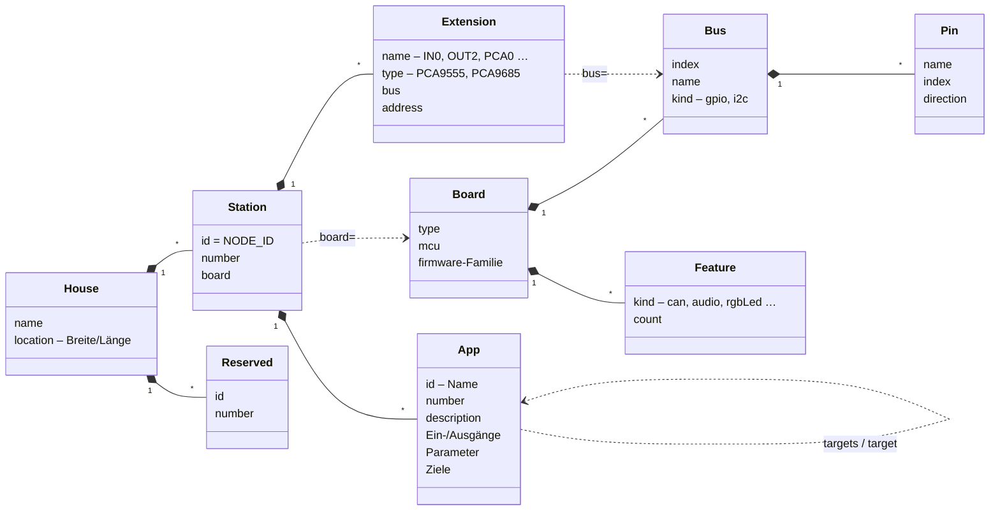
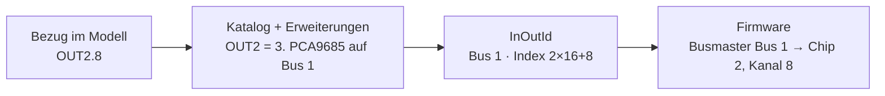
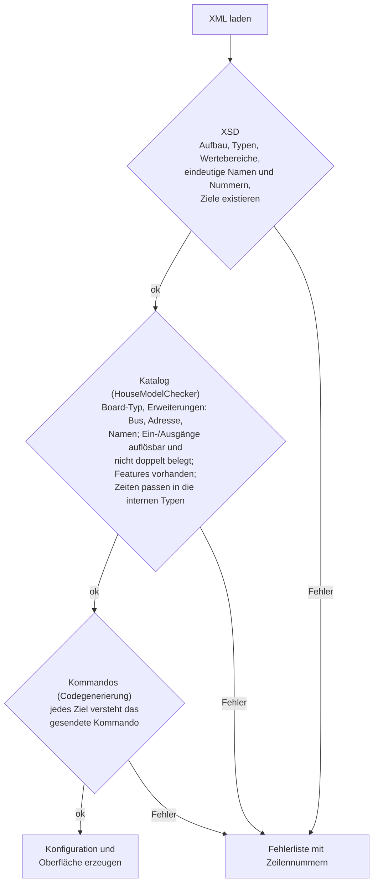
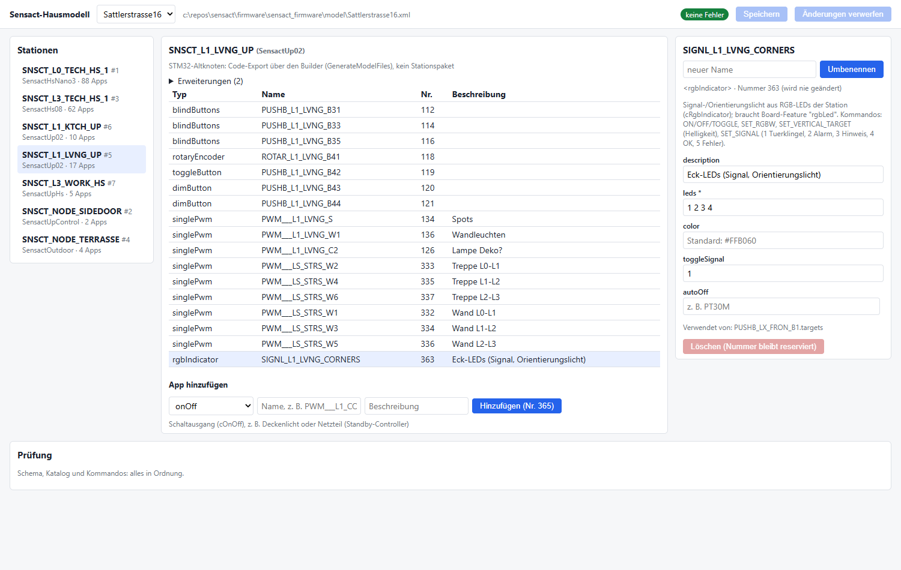

# 2 Hausmodell und Katalog

Das Hausmodell ist die **einzige Quelle der Wahrheit** für das, was im Haus verbaut ist und wie es
zusammenarbeitet. Alles andere – Konfiguration der Stationen, Weboberflächen, Prüfberichte – wird
daraus erzeugt. Es liegt als XML im Git und wird im [Editor](#bearbeiten) oder von Hand gepflegt.

| Datei | Inhalt |
|---|---|
| `firmware/sensact_firmware/model/Sattlerstrasse16.xml` | das Haus: Stationen, Erweiterungen, Apps |
| `model/catalog.xml` | was es an Hardware gibt: Board-Typen und Erweiterungs-Chips |
| `model/Testmodel.xml` | kleines Haus für die automatischen Tests |
| `model/schema/sensact-house.xsd`, `sensact-catalog.xsd` | Aufbau, Datentypen, Hilfetexte (der Editor baut seine Formulare daraus) |

## Aufbau



Links das Haus (Hausmodell), rechts die Hardwarebeschreibung (Katalog). Eine Station verweist auf
einen Board-Typ; ihre Erweiterungen hängen an Bussen dieses Boards; Apps verweisen auf Ein- und
Ausgänge und auf andere Apps.

Ein Ausschnitt:

```xml
<station id="SNSCT_L1_KTCH_UP" number="6" board="SensactUp02">
  <extension name="PCA0" type="PCA9685" bus="BB" address="0x40" />
  <rotaryEncoder id="ROTAR_L1_KTCH_B21" number="78" encoder="ROTENC0" target="PWM___L1_KTCH_S1" />
  <blindButtons id="PUSHB_L1_KTCH_B25" number="82" inputUp="INTERNAL.6" inputDown="INTERNAL.7" target="BLIND_L1_KTCH_J1" />
  <singlePwm id="PWM___L1_KTCH_S1" number="94" description="Spots" outputs="BB.0 BB.1 BB.2 BB.3"
             minimalBrightness="0.781" standbyController="STDBY_L0_TECH_48V" />
  <rgbIndicator id="SIGNL_L1_KTCH_CORNERS" number="364" description="Eck-LEDs (Signal, Orientierungslicht)"
                leds="1 2 3 4" toggleSignal="1" />
</station>
```

Der Drehgeber der Küche dimmt die Spots der Küche (lokal), die Rollladentaster fahren einen Rollladen,
dessen Relais an der Technikstation im Keller hängen (über CAN), und die Spots halten das 48-V-Netzteil
der Technikstation wach.

## Namen und Nummern

Jede App und jede Station hat **zwei** Kennungen:

- **Name** (`id`), lesbar und nach Konvention aufgebaut: `TYP__EBENE_RAUM_GERÄT`, z. B.
  `PWM___L1_KTCH_S1` = Dimmer, Erdgeschoss, Küche, Spots 1.
  - Typ (5 Zeichen): `PUSHB` Taster, `ROTAR` Drehgeber, `POWIT` Schaltausgang, `PWM__` Dimmer,
    `BLIND` Rollladen, `RGBW_` Farblicht, `SIGNL` Signal-LEDs, `SOUND` Klingel, `PUMP_` Pumpe,
    `STDBY` Netzteil, `LIBAR` Lichtschranke/Bewegungsmelder, `REMOT` Fernbedienung, `SNSCT` Station.
  - Ebene: `L0` Keller, `L1` Erdgeschoss, `L2` Obergeschoss, `L3` Dachgeschoss, `LX` außen, `LS` Treppenhaus.
  - Raum (4 Zeichen): `KTCH` Küche, `LVNG` Wohnen, `BATH` Bad, `CORR` Flur, `WORK` Arbeiten …
  Die Weboberfläche gruppiert nach Ebene und Raum anhand dieses Namens.
- **Nummer** (`number`), die Adresse auf dem CAN-Bus und in den Konfigurationen anderer Stationen.

> **Nummern sind ewig.** Eine Nummer wird nie geändert und nie wiederverwendet. Gelöschte Apps
> bleiben als `<reserved id="…" number="…"/>` stehen. Der Editor vergibt für neue Apps die nächste
> nie benutzte Nummer und löscht nur Apps, auf die nichts mehr verweist.

Weitere Regeln, bei denen die **Reihenfolge** zählt: Stationen nicht umsortieren (die Reihenfolge ergibt
die interne Stationskennung), Erweiterungen gleichen Typs auf einem Bus nicht umsortieren (die
Reihenfolge ergibt den Chip-Index). Die Reihenfolge der Apps einer Station ist nur die
Anzeigereihenfolge.

## Ein- und Ausgänge

Apps sprechen Hardware über lesbare Bezüge an; der Builder übersetzt sie in eine 16-bit-Kennung
(`InOutId`: 2 Bit Bus, 14 Bit Index auf dem Bus), die die Firmware zur Laufzeit an den richtigen
Treiber gibt.

| Schreibweise | Beispiel | Bedeutung |
|---|---|---|
| `Erweiterung.Kanal` | `IN0.13`, `OUT2.8` | Kanal 13 des Chips `IN0` dieser Station |
| benannter Pin | `IO3`, `O1`, `K1` | Pin des Boards aus dem Katalog |
| `Bus.Index` | `INTERNAL.19`, `BB.4` | Index auf einem Bus des Boards |
| `INPUT0` / `INPUT1` | | Eingang, der immer 0 bzw. 1 liefert |
| `NONE` | | unbeschalteter Ausgang (z. B. fehlender W-Kanal eines RGBW-Streifens) |



## Der Katalog

Der Katalog beschreibt Hardware **einmal je Typ**, nicht je Station:

- **Board-Typen** mit Mikrocontroller und **Firmware-Familie** (`esp32`, `stm32f103`, `stm32-legacy`),
  ihren Bussen (GPIO direkt, I2C für Erweiterungen), benannten Pins und **Features**
  (`can`, `wifi`, `ethernet`, `audio`, `rotaryEncoder` mit Anzahl, `rgbLed` mit Anzahl, `fingerprint`,
  `milight`, `display`).
- **Erweiterungs-Chips** mit Busart, Adressbereich, Richtung und Kanalzahl
  (PCA9555: 16 Eingänge, PCA9685: 16 PWM-Ausgänge).

Eine neue Station mit vorhandenem Board-Typ braucht deshalb **keinen Code**, nur Modelleinträge.

## Einheiten

Im Modell stehen nur lesbare Werte; umgerechnet wird beim Erzeugen der Konfiguration:

| Größe | Im Modell | Auf dem Gerät |
|---|---|---|
| Zeit | ISO-8601-Dauer: `PT20S`, `PT30M`, `PT1H30M`, `P1D`; `PT0S` = unbegrenzt/aus | Millisekunden bzw. Sekunden |
| Helligkeit | Prozent 0…100 (bis drei Nachkommastellen) | 0…65535 |
| Farbe | `#RRGGBB` | 24 bit RGB |
| Ort | Breiten-/Längengrad im `<location>` des Hauses | für die Dämmerungsberechnung |

## Prüfungen

Ein Modell, das nicht stimmt, soll am Schreibtisch auffallen. Editor und Builder prüfen mit demselben
Code (`modellib`), sammeln **alle** Fehler mit Zeilennummer und speichern bzw. erzeugen nur aus einem
fehlerfreien Modell:



Beispiele für Fehlermeldungen: „`IN0.13` ist schon von `PUSHB_L0_CORR_B11.input` belegt“,
„`<rotaryEncoder>` braucht das Board-Feature `rotaryEncoder`“, „LED 5 gibt es nicht (SensactUp02 hat
5 RGB-LEDs, 0..4)“.

## Bearbeiten



Der Editor (`dotnet run --project editor`, nur auf `localhost`) zeigt links die Stationen, in der Mitte
die Apps der gewählten Station, rechts das Formular der gewählten App. Das Formular entsteht aus dem
XSD: Auswahllisten, Vorschläge für Ein-/Ausgänge und Ziele, Hilfetexte. Unten steht das Ergebnis der
Prüfung. Gespeichert wird nur ein fehlerfreies Modell, und nur die geänderten Stellen der Datei
werden angefasst (saubere Git-Diffs). Umbenennen zieht alle Verweise mit; die Nummer bleibt.

Bedienung Schritt für Schritt: [Betrieb und Änderungen](../nutzer/betrieb-und-aenderungen.md).
Regeln und Schreibweisen im Detail: [model/README.md](../../firmware/sensact_firmware/model/README.md).
