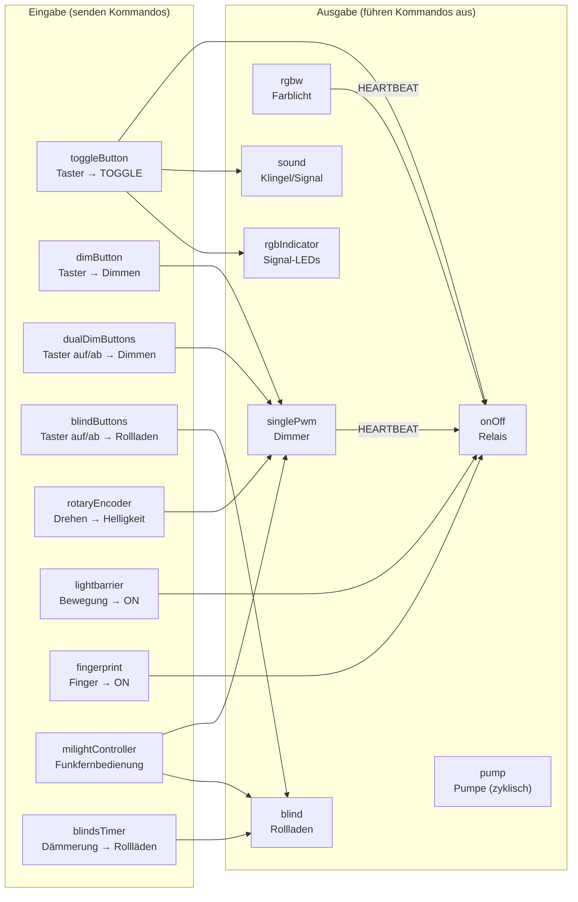
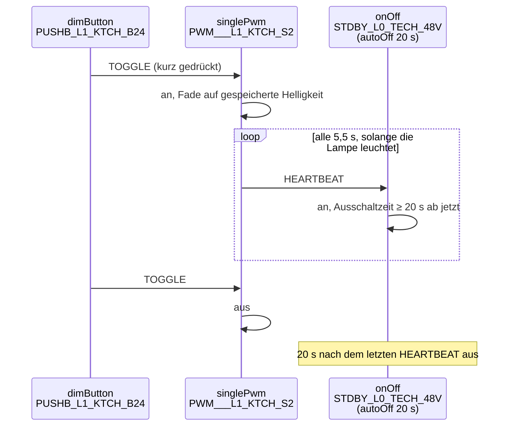
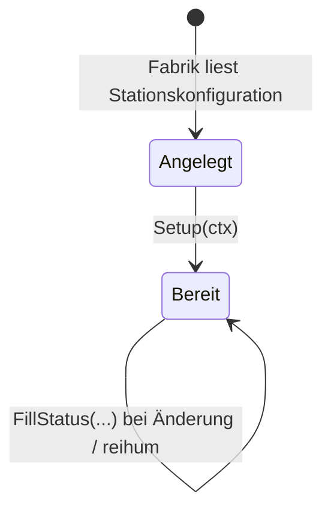
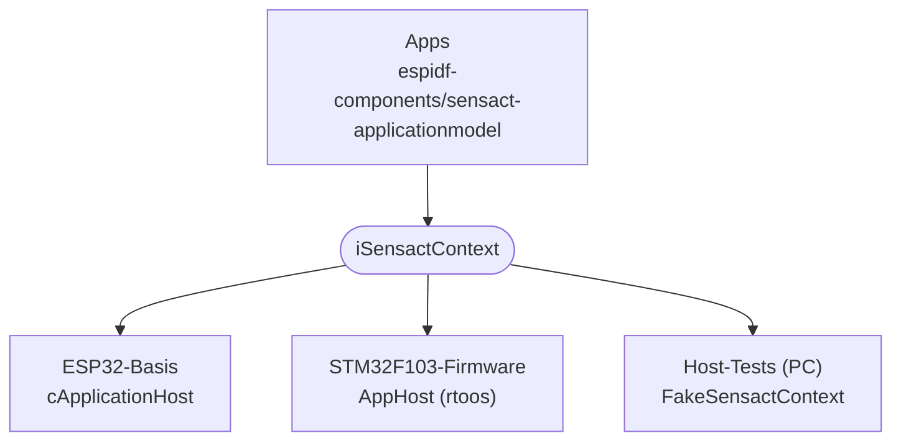

# 3 Apps, Kommandos und Status

## Was eine App ist

Eine App ist die kleinste Einheit mit eigenem Verhalten: ein Taster, ein Drehgeber, eine Lampe, ein
Rollladen, eine Klingel. Jede App

- hat eine im Haus eindeutige **Nummer** (ihre Adresse) und einen Namen,
- läuft auf genau **einer Station** und benutzt deren Ein- und Ausgänge,
- versteht eine Menge von **Kommandos** und ignoriert alle anderen,
- meldet ihren Zustand als **Status** (vier 16-bit-Werte),
- schickt selbst Kommandos an ihre **Ziele** – andere Apps, lokal oder irgendwo im Haus.

Dadurch entsteht das Verhalten des Hauses aus Verknüpfungen im Modell, nicht aus Programmcode: „Taster
B22 schickt `TOGGLE` an Lampe C1“ ist eine Zeile XML.

## Rollen

Dazu kommt die **Knoten-App** jeder Station (`SNSCT_…`): `PING` → `PONG`, `IDENTIFY` (Station zeigt
sich, z. B. blau blinkende LEDs).

Die verbindliche Beschreibung jeder App – Kommandos, Parameter, Statusbelegung, Sonderfälle – steht in
der [App-Referenz](../../espidf-components/sensact-applicationmodel/README.md).

## Kommandos

Kommandos sind ein festes, hausweites Vokabular (`best_binary_buffers_schema/sensact_commandTypes.enums.cs`).
Neue Kommandos werden **nur hinten angefügt**, weil ihre Nummern auf dem Bus stehen.

| Gruppe | Kommandos | Typische Empfänger |
|---|---|---|
| Schalten | `ON(ms)`, `OFF(ms)`, `TOGGLE`, `TOGGLE_SPECIAL` | Relais, Dimmer, Farblicht, Signal |
| Stellen | `SET_VERTICAL_TARGET(v)`, `STEP_VERTICAL(s)`, `UP`, `DOWN`, `START`, `STOP` | Dimmer, Rollladen, Lautstärke |
| Farbe/Signal | `SET_RGBW(r,g,b,w)`, `SET_SIGNAL(n)` | Farblicht, Signal-LEDs, Klingel |
| Versorgung | `HEARTBEAT(sender)` | Netzteil-Relais („ich brauche dich noch“) |
| Parameter | `SET_PARAM(i,v)`, `SAVE_PARAM` | Klingel (Tag-/Nachtlautstärke) |
| Station | `PING`, `IDENTIFY(ms)`, `RESET`, `START_IAP` | Knoten-App |

Dieselben Kommandos kommen aus drei Quellen und wirken gleich: von einer lokalen App, über CAN von
einer anderen Station, aus der Weboberfläche.

## Ein Beispiel: Dimmer mit Netzteil

Die Spots im Haus hängen an einem 48-V-Netzteil, das nur laufen soll, solange irgendeine Lampe leuchtet.
Statt einer zentralen Logik gilt ein einfaches Protokoll:

Das Netzteil braucht keine Liste seiner Verbraucher, und eine ausgefallene Station kann es nicht dauerhaft
eingeschaltet lassen.

## Lebenszyklus und Takt

- Die Station tickt alle **20 ms**. Jede App ist spätestens alle **100 ms** dran (Bucket-Rotation); Apps,
  die gerade etwas Zeitkritisches tun (Fade, Rollladenfahrt), melden `NeedsFastLoop()` und laufen jeden
  Tick.
- Apps rechnen **zeitbasiert** (`ctx->Now()`), nie in „Anzahl Aufrufe“.
- Eine für Benutzer sichtbare Änderung meldet `Loop()` mit `OK_CHANGED`; dann geht der Status sofort an
  die Weboberfläche. Sonst wird er reihum als regelmäßiger Status verschickt.

## Unabhängig von der Hardware

Apps sprechen die Außenwelt **nur** über das Interface `iSensactContext` an: Zeit, Ein-/Ausgänge,
Kommandos senden, RGB-LEDs, Ton, gespeicherte Parameter, Uhrzeit. Kein App-Code kennt ESP-IDF oder
STM32-Register. Daraus folgt dreierlei:

1. **Eine Implementierung** für ESP32- und STM32F103-Stationen.
2. **Testbar am PC** mit einem nachgebildeten Kontext (GoogleTest, s. [Qualitätssicherung](08-qualitaetssicherung.md)).
3. **Hardware-Besonderheiten** (Funkempfänger, Fingerabdruckleser) sitzen als Adapter in der
   Board-Initialisierung, nicht in der App.

Welche App-Typen eine Station kennt, hängt von ihrer Firmware-Familie ab: Die F103-Firmware lässt Ton,
Funk, Fingerabdruck und den Dämmerungs-Timer weg (keine Hardware bzw. keine Uhr).

## Lokal oder über den Bus

Der App-Host einer Station entscheidet bei jedem gesendeten Kommando:

- Ziel-App läuft **hier** → direkter Aufruf des Handlers.
- Ziel-App läuft **woanders** → CAN-Nachricht an die Nummer der Ziel-App (s. [Kommunikation](04-kommunikation.md)).

Jede Station kennt dazu die Namen und Nummern **aller** Apps des Hauses (aus ihrer Konfiguration), legt
aber nur ihre eigenen an.

## Einen neuen App-Typ einführen

Ein neuer App-Typ ändert die Basis-Firmware (neue Klasse, neues Konfigurationsschema) und damit die
Kompatibilitätskennung der Stationspakete. Die Schritte – C++-Klasse, Modellklasse, Konfigurationsschema,
App-Fabrik, XSD, Import – stehen in [model/README.md](../../firmware/sensact_firmware/model/README.md#neuer-app-typ).
