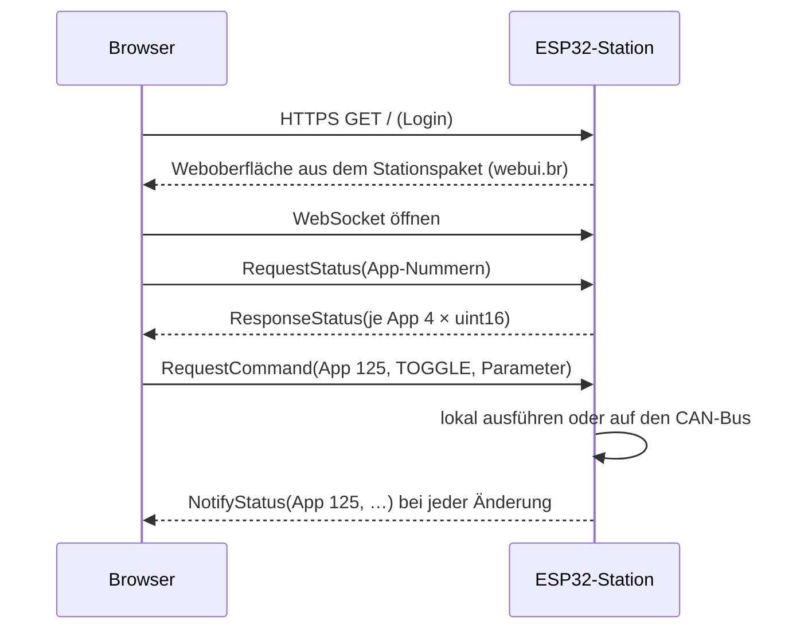

# 4 Kommunikation

sensact hat zwei Kommunikationswege mit klar getrennten Aufgaben:

| Weg | Zwischen | Wofür | Eigenschaften |
|---|---|---|---|
| **CAN-Bus** | Stationen untereinander | Kommandos von App zu App | robust, echtzeitfähig, keine Zentrale, funktioniert ohne Netzwerk |
| **WebSocket** (HTTPS, WLAN/Ethernet) | Browser ↔ ESP32-Station | Bedienen, Status, Diagnose, Updates | nur ESP32-Stationen, Login nötig |

Das Haus funktioniert vollständig ohne WLAN: Taster, Lampen, Rollläden und Automatiken laufen über CAN.

## CAN-Bus

- **125 kbit/s**, 29-bit-IDs (Extended Frames), bis 8 Datenbytes.
- Physik: eine durchgehende Leitung durch das Haus, Transceiver je Station (z. B. SN65HVD230 auf dem
  sensactUp).
- Gleichberechtigte Teilnehmer: Jede Station sendet, wenn eine ihrer Apps ein Kommando an eine
  App auf einer anderen Station schickt. Die Arbitrierung des CAN-Busses regelt gleichzeitige Zugriffe.

### Nachrichtenformat im Betrieb („altes CAN-ID-Schema“)

Alle Stationen im Haus sprechen heute dieses Schema (`USE_NEW_CAN_ID = false`). Es kennt **nur
Kommandos an Apps**:

```
 CAN-ID (29 bit)                         Daten (1..8 Byte)
┌──────────────────┬──────────────┐     ┌─────────┬──────────────────────────────┐
│ 0 (Typ = Kommando)│ Ziel-App-Nr. │     │ Kommando│ Parameter, little endian (≤7)│
│   Bits 28..10    │  Bits 9..0   │     │ Byte 0  │ Byte 1..7                    │
└──────────────────┴──────────────┘     └─────────┴──────────────────────────────┘
```

Beispiele:

| Bedeutung | CAN-ID | Daten |
|---|---|---|
| `TOGGLE` an `POWIT_L1_KTCH_C1` (Nr. 88) | `0x058` | `0F` |
| `ON(0)` an `POWIT_LX_FRON_W1` (Nr. 190) | `0x0BE` | `0C 00 00 00 00` |
| `HEARTBEAT(94)` an `STDBY_L0_TECH_48V` (Nr. 351) | `0x15F` | `19 5E 00 00 00` |
| `IDENTIFY(5000)` an die Knoten-App `SNSCT_L1_LVNG_UP` (Nr. 5 = Stationsnummer) | `0x005` | `20 88 13 00 00` |

Kommandonummern: `best_binary_buffers_schema/sensact_commandTypes.enums.cs` (z. B. `ON` = 12,
`TOGGLE` = 15, `HEARTBEAT` = 25, `IDENTIFY` = 32). Die Parameter jedes Kommandos und ihre Reihenfolge sind
generiert (`parseCommand.inc`), sodass Sender und Empfänger nie auseinanderlaufen.

Jede Station nimmt alle Kommando-Nachrichten an und prüft, ob die Ziel-App bei ihr läuft. Status und
Events gehen in diesem Schema **nicht** über den Bus; den Status einer App sieht man in der Weboberfläche
der Station, auf der sie läuft.

### Erweitertes Schema („neues CAN-ID-Schema“)

Vorbereitet in der Middleware (`espidf-components/sensact-middleware/can_message_builder_parser.hh`),
im Haus noch nicht eingeschaltet: Der Nachrichtentyp steht in der ID, das Kommando ebenfalls, die Daten
sind volle 8 Byte Parameter.

```
 Bits 28..24        Bits 23..8                 Bits 7..0
┌───────────────┬──────────────────────────┬─────────────────────┐
│ Nachrichtentyp │ App-Nr. bzw. Stationsnr. │ Kommando / Event /  │
│                │ (Station: Bits 23..16)   │ Status-Kennung      │
└───────────────┴──────────────────────────┴─────────────────────┘
```

| Typ | Wert | Inhalt |
|---|---|---|
| `NodeEvent` | 0x00 | Station meldet sich (gestartet, bereit, Bootloader bereit) |
| `ApplicationEvent` | 0x01 | Ereignis einer App (z. B. `PONG`) |
| `NodeCommand` | 0x02 | Auftrag an eine Station (Reset, Daten in Zwischenspeicher, in Flash kopieren) |
| `NodeCommandAcknowledge` | 0x03 | Quittung dazu |
| `ApplicationCommand` | 0x04 | Kommando an eine App |
| `CommandAcknowledge` | 0x05 | Quittung eines App-Kommandos |
| `ApplicationStatus` | 0x06 | Status einer App |

Damit würden Status und Events hausweit sichtbar, und die `NodeCommand`s tragen die geplante
[Übertragung der Konfiguration an STM32F103-Stationen](06-konfiguration-und-auslieferung.md#stm32f103-heute-und-geplant).
Umgestellt werden kann nur das ganze Haus auf einmal (oder mit einer Übergangsphase, in der Kommandos in
beiden Schemata verstanden werden).

### Diagnose

- Arbeitsbereich **CAN-Monitor** der Weboberfläche: liest mit, was die Station auf dem Bus sieht.
- F103-Stationen: Konsole (USART, 115200 Baud) mit Fehlerzählern von CAN, I2C und PCA9685; die LED am
  Knopf blinkt zweimal rot, wenn CAN gestört ist.
- `runware/udpmonitor`: älteres PC-Werkzeug zum Mitlesen.

## Browser ↔ Station



- Transport: HTTPS mit einem Zertifikat je Station (signiert von einer privaten CA), WebSocket für
  alles Interaktive.
- Format: **BestBinaryBuffers** – Nachrichten werden als annotierter C#-Code beschrieben
  (`best_binary_buffers_schema/*.cs`), daraus entstehen C++ für die Firmware und TypeScript für die
  Oberfläche. Beide Seiten sprechen garantiert dasselbe Format.
- Namensräume (Plugins) der Station: `sensact` (Apps bedienen), `nodemaster` (Ein-/Ausgänge direkt),
  `canmonitor`, `journal`, `firmwarelog`, `systeminfo`, `wifimanager`, `usersettings`, je nach Station
  `fingerprint` u. a.
- Ein Kommando aus dem Browser nimmt denselben Weg wie eines von einer lokalen App: Läuft die Ziel-App
  auf einer anderen Station, geht es auf den CAN-Bus. So lässt sich von jeder ESP32-Station aus jede App
  im Haus schalten („Nur diese Station“ aus).
