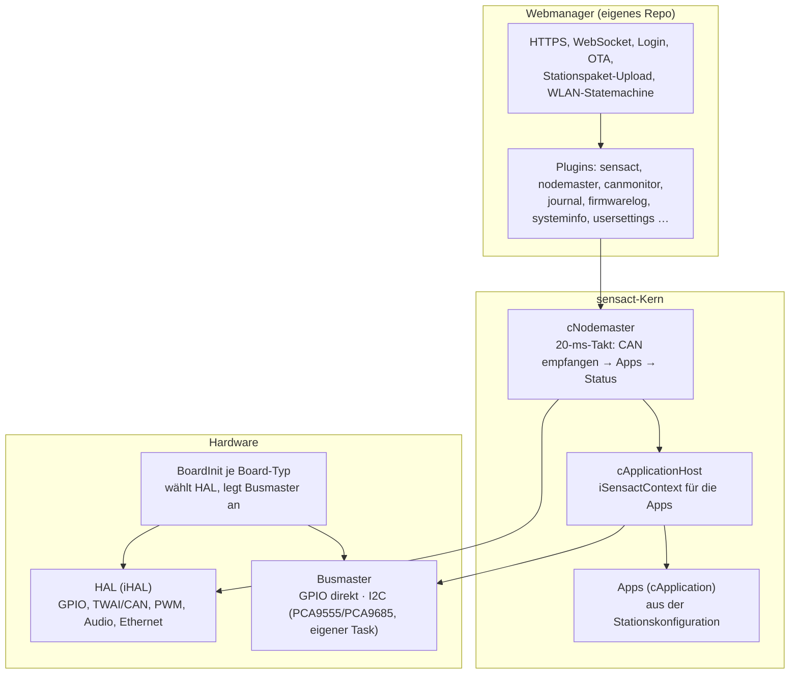
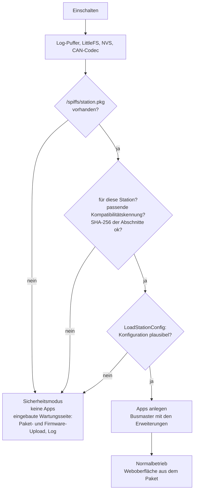
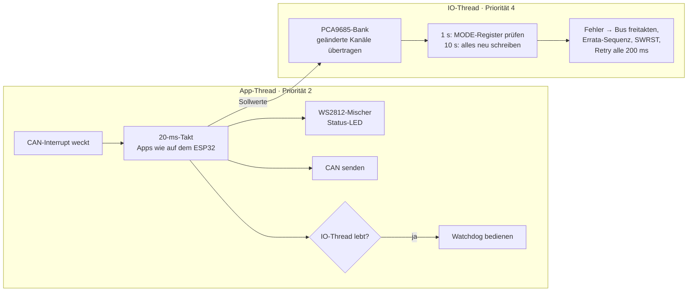
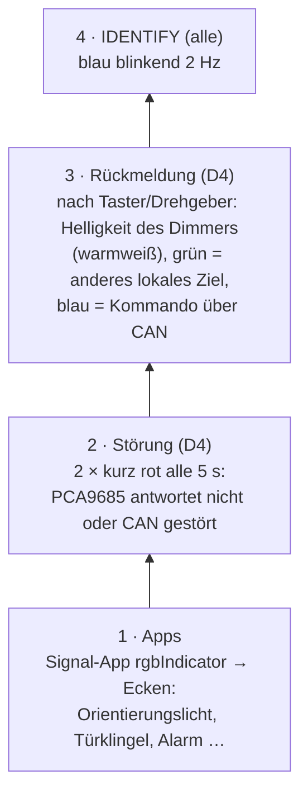

# 5 Stationen und Firmware

## Drei Firmware-Familien

Der Katalog ordnet jedem Board-Typ eine Firmware-Familie zu:

| Familie | Boards | Stationen im Haus | Konfiguration | Update |
|---|---|---|---|---|
| `esp32` – **Basis-Firmware** | SensactHsNano3, SensactUpHs, SensactUp3, SensactUpControl, SensactOutdoor (ESP32-S3) | TECH_HS_1, L3_WORK_HS, SIDEDOOR, TERRASSE | **Stationspaket**, im Browser hochgeladen | OTA im Browser |
| `stm32f103` – **rtoos-Firmware** | SensactUp02 (sensactUp Rev 0.2, STM32F103CB, 128 KB Flash, 20 KB RAM) | L1_LVNG_UP, L1_KTCH_UP | einkompiliert (Format wie im Stationspaket) | über CAN (Bootloader; einmalig SWD) |
| `stm32-legacy` – Altfirmware | SensactHs08 (STM32F407) | L3_TECH_HS_1 | generierter C++-Code | ST-Link |

Gemeinsam ist allen: dieselben App-Nummern, dieselben Kommandos, derselbe CAN-Bus. Die ESP32- und die
F103-Familie teilen sich zusätzlich den App-Code.

## ESP32-Basis-Firmware

### Schichten

- **Stationsneutral:** Die Firmware enthält alle App-Typen und alle HAL-Varianten. Welche Apps mit
  welchen Parametern laufen und welche Erweiterungs-Chips an den Bussen hängen, kommt zur Laufzeit aus
  der Stationskonfiguration. Je Board-Typ gibt es eine kleine Board-Initialisierung
  (`main/hal/<BoardType>/board_init.hh`); eine neue Station mit bekanntem Board braucht keinen Code.
- Noch stationsspezifisch einkompiliert sind Stationsname/Hostname und das HTTPS-Zertifikat; deshalb
  wird die Firmware je Gerät gebaut, aber nicht mehr je Hausmodell.

### Start und Sicherheitsmodus

Ein misslungener oder unpassender Upload kann die Station nicht unbedienbar machen: Die Wartungsseite ist
fest im Firmware-Image, und ein neues Paket wird erst nach vollständiger Prüfung aktiv.

### Weitere Bausteine

- **Journal:** Ringpuffer der letzten Ereignisse in RAM, der einen Neustart übersteht.
- **Firmware-Log im Browser:** Jede Log-Zeile geht weiter an die UART und zusätzlich in einen Puffer
  (48 Zeilen ab dem Start); der Arbeitsbereich Terminal zeigt ihn live, Warnungen und Fehler zählt die
  Glocke in der Titelleiste.
- **Netzwerk:** WLAN mit Fallback-Access-Point oder (Boards mit Ethernet) Ethernet ohne WLAN.
- **Uhrzeit:** per SNTP; zeitgesteuerte Apps (Dämmerungs-Timer, Tag/Nacht-Lautstärke) warten, bis die
  Uhr gestellt ist.

## STM32F103-Stationen (sensactUp) auf rtoos

Die Unterputz-Stationen im Wohnzimmer und in der Küche sind sensactUp-Platinen von 2015 mit sehr wenig
Speicher und ohne Netzwerk. Ihre Firmware (`firmware/sensact_firmware_f103`) läuft auf
[rtoos](https://github.com/klaus-liebler/rtoos), einem C++26-Echtzeitbetriebssystem, dessen Treiber ihre
Konfiguration als Template-Argument bekommen und zur Compile-Zeit gegen Referenzhandbuch, Datenblatt und
Errata geprüft werden – ohne Laufzeitkosten.

Wichtige Eigenschaften:

- **Dieselben Apps** wie die ESP32-Basis (Ton, Funk, Fingerabdruck und Dämmerungs-Timer weggelassen).
- **Robuster I2C für lange Leitungen:** Die Apps setzen nur Sollwerte. Der IO-Thread überträgt sie,
  erkennt einen durch Störungen zurückgesetzten PCA9685 und richtet ihn neu ein und befreit einen
  hängenden Bus (bis zu neun SCL-Takte, Sequenz aus Errata ES096 2.8.7, Software-Reset). Ein gestörter
  Bus hält nie den App-Takt auf.
- **Watchdog** (2–4 s) wird nur bedient, wenn beide Threads laufen.
- **Kein Heap im Betrieb:** Apps legen ihre Objekte beim Start in einem festen Bereich an, der danach
  versiegelt wird.
- **Konfiguration einkompiliert:** dieselbe Stationskonfiguration wie im ESP32-Paket, vom Builder als
  Datei erzeugt (`GenerateStm32F103Files`). Firmware und Konfiguration sind **ein Paket**.
- **CAN-Bootloader** (erste 16 KB): nach jedem Reset 1 s Fenster für ein Update, nach `START_IAP` an die
  Knoten-App 10 s; das Paket kommt über den CAN-Bus, s.
  [Konfiguration und Auslieferung](06-konfiguration-und-auslieferung.md#stm32f103-firmware-und-modell-als-ein-paket-über-can).

### Licht als Rückmeldung (WS2812)

Fünf RGB-LEDs: D4 neben dem Knopf, vier in den Ecken hinter der Abdeckung (diffus, gedämpft).
Die Firmware mischt vier Ebenen, die obere gewinnt:

Die Versorgung der LED-Kette wird nur eingeschaltet, solange etwas leuchtet.

### Emulation

Die Firmware läuft unverändert im Emulator Renode mit einem Modell der Platine (zwei PCA9685, CAN-Hub mit
einem zweiten, scriptbaren Teilnehmer, WS2812 über Timer und DMA). Damit lassen sich Tastendrücke,
CAN-Kommandos und die resultierenden PWM- und LED-Werte ohne Hardware prüfen (s.
[Qualitätssicherung](08-qualitaetssicherung.md)).

Pinbelegung, Bauen, Flashen: [sensact_firmware_f103/README.md](../../firmware/sensact_firmware_f103/README.md).

## Altfirmware (STM32F407)

`SNSCT_L3_TECH_HS_1` (SensactHs08) läuft weiter mit der alten STM32-Firmware
(`firmware/sensact_firmware_stm32`, `firmware/firmwareCubeIDE`), die ihre Apps selbst implementiert. Sie
bekommt ihren Teil des Hausmodells als generierte C++-Dateien (`applicationInitializers.inc` u. a.).
Auf dem Bus ist sie von den anderen Stationen nicht zu unterscheiden. Eine Umstellung auf die gemeinsamen
Apps (wie beim F103) ist möglich, aber nicht geplant.
