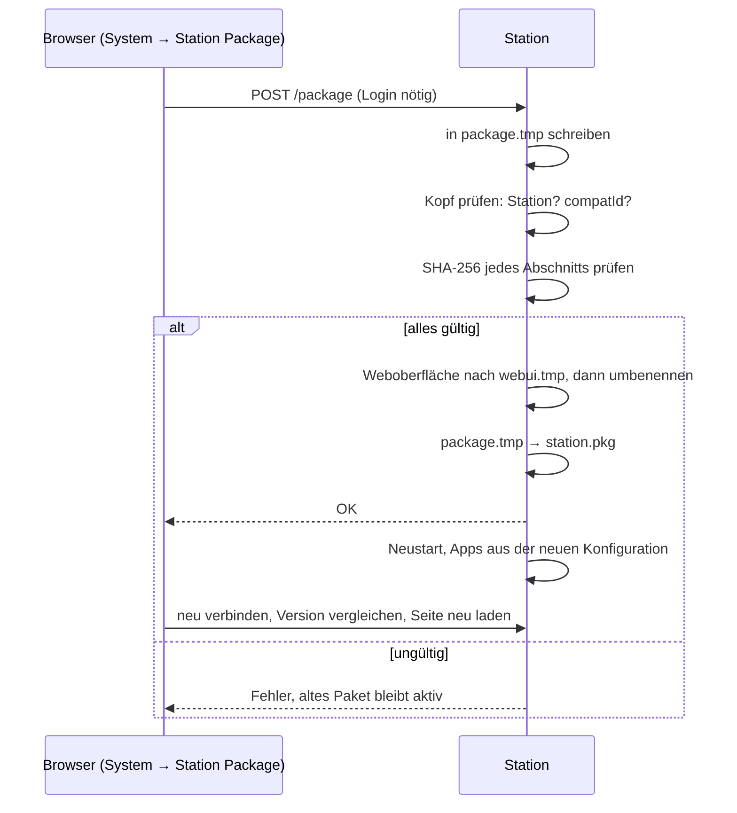
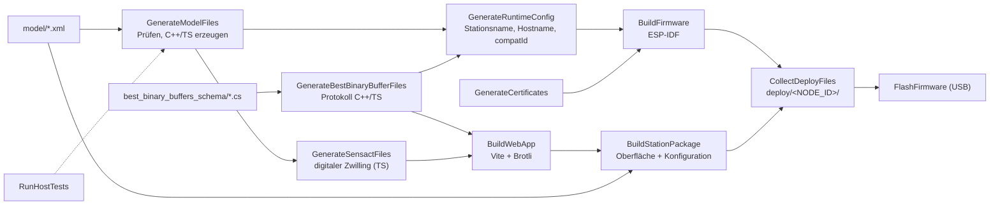
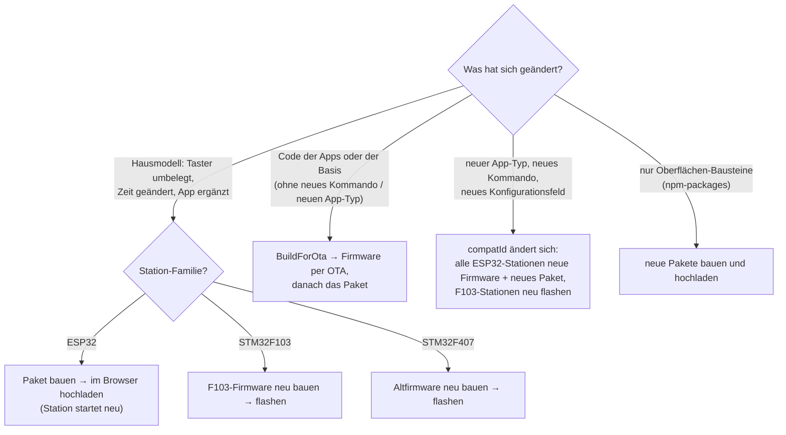
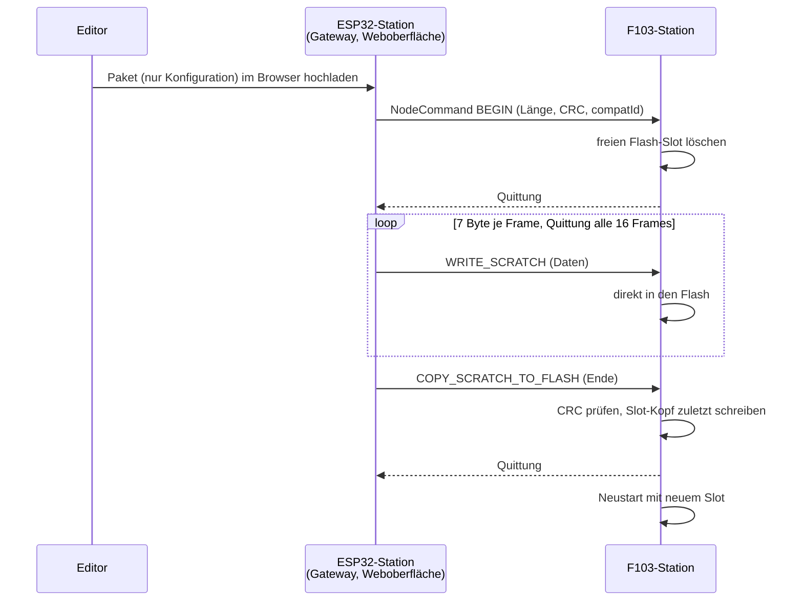

# 6 Konfiguration und Auslieferung

## Drei unabhängig austauschbare Teile

Eine ESP32-Station besteht aus drei Teilen, die getrennt erneuert werden:

| Teil | Inhalt | Ändert sich, wenn … | Weg aufs Gerät |
|---|---|---|---|
| **Basis-Firmware** | alle App-Typen, alle HAL-Varianten, Webserver, Wartungsseite | sich Code ändert (neuer App-Typ, Fehlerbehebung) | einmalig USB, danach OTA im Browser |
| **Stationskonfiguration** | welche Apps mit welchen Parametern, welche Erweiterungs-Chips | sich das Hausmodell ändert | im Stationspaket |
| **Weboberfläche** | Bedienoberfläche mit den Apps dieser Station | sich das Hausmodell oder die Oberfläche ändert | im Stationspaket |

Konfiguration und Weboberfläche gehören zusammen und reisen deshalb als **eine Datei**: das
Stationspaket. Es gibt keinen Zustand „neue Konfiguration, alte Oberfläche“.

## Das Stationspaket

```
┌──────────────────────────────────────────────┐
│ Kopf (128 Byte)                              │
│   Magic "SNSCTPKG", Format, Abschnittszahl   │
│   Stationsname (NODE_ID)                     │
│   Kompatibilitätskennung (compatId, 32 Byte) │
│   lesbare Beschreibung                       │
├──────────────────────────────────────────────┤
│ Abschnittstabelle (je 48 Byte)               │
│   Art, Offset, Länge, SHA-256                │
├──────────────────────────────────────────────┤
│ Abschnitt 1: Weboberfläche (Brotli)          │
├──────────────────────────────────────────────┤
│ Abschnitt 2: Stationskonfiguration           │
│   BestBinaryBuffers, Schema sensactcfg       │
└──────────────────────────────────────────────┘
```

- Format: `espidf-component-webmanager/cpp/station_package.hh` (Gerät), `builder/StationPackage.cs` (PC).
- **Kompatibilitätskennung:** SHA-256 über alles, was Basis und Paket gemeinsam verstehen müssen –
  Kommandos, Events, Dispatch, Protokoll- und Konfigurationsschema. Sie hängt **nicht** am Hausmodell.
  Folge: Eine Modelländerung braucht nur ein neues Paket; eine Basis mit neuem App-Typ oder neuem
  Kommando braucht neue Pakete für alle Stationen.
- **Konfiguration:** Stationsname, Hausname, Erstellungszeit, Busse mit Erweiterungs-Chips, die Apps der
  Station mit allen Parametern, dazu Namen und Nummern aller Apps des Hauses (für Anzeigen und Logs).

### Upload auf dem Gerät



## Der Builder

Der Builder (`firmware/sensact_firmware/builder`, C#, `dotnet run --project builder -- <Phase>`) führt alle
Schritte aus; die gemeinsame Bibliothek `firmware_builder_common` teilt er mit anderen Projekten.



Zusammengesetzte Phasen für die üblichen Aufgaben:

| Aufgabe | Phase | Ergebnis |
|---|---|---|
| neue Station erstmals in Betrieb nehmen (per USB angeschlossen) | `Pipeline --model <Haus>` | geflasht, mit Paket im Dateisystem |
| Hausmodell geändert | `BuildPackage --model <Haus>` (aktives Board) oder `BuildPackageFor --nodeId <Station> --model <Haus>`, im Editor „Stationspaket bauen“ | `deploy/<NODE_ID>/<NODE_ID>.pkg` |
| Basis-Firmware geändert | `BuildForOta --model <Haus>` | Firmware **und** Paket in `deploy/<NODE_ID>/` |
| Build ohne Gerät | `PipelineOffline --nodeId <Station> --model <Haus>` | wie Pipeline, ohne Flashen, mit Test-Zertifikat |
| F103-Station | `GenerateStm32F103Files --model <Haus> --nodeId <Station>`, danach CMake | `sensact_f103.bin` |

Jeder Build läuft zuerst durch die Host-Tests der Apps; ein roter Test bricht ab.

## Welche Änderung braucht was?



Eine Station, deren Paket nach einem Firmware-Update nicht mehr passt, startet im Sicherheitsmodus und
wartet auf das passende Paket – sie wird nicht mit unpassender Konfiguration betrieben.

## Geräte und Geheimnisse

- **Board-Archiv** (außerhalb des Repos, je Gerät ein Ordner nach MAC-Adresse): `board_info.json`
  (Chip, MAC, Zeitstempel, Web-Passwort), `sensact.json` (welche Station das Gerät ist), Zertifikat und
  Schlüssel, Flash-Encryption-Key. `PrepareContextWithRealHardware` liest ein per USB angeschlossenes Gerät
  aus und macht es zum aktiven Board; `SelectBoard` wählt ein bekanntes Gerät ohne Anschluss.
- **Zertifikate:** je Station ein Zertifikat, signiert von einer privaten CA; HTTPS im Browser.
- Details: [board-provisioning.md](../../firmware/sensact_firmware/docs/board-provisioning.md),
  [build-process.md](../../firmware/sensact_firmware/docs/build-process.md).

## STM32F103: heute und geplant

**Heute:** Die Stationskonfiguration steckt im Firmware-Image. Jede Modelländerung an einer F103-Station
heißt: `GenerateStm32F103Files`, neu bauen, per SWD oder seriell flashen.

**Geplant** (Konzept, Etappen F1–F5): dasselbe Prinzip wie beim ESP32, nur über CAN.



- Ein Image für alle sensactUp-Stationen; zwei Konfigurations-Slots à 4 KB am Ende des Flashs, der Kopf
  wird zuletzt geschrieben, sodass ein Abbruch nie einen halben Slot hinterlässt.
- Kompakte Konfiguration nur mit den Namen der lokalen Apps und ihrer Ziele (< 1 KB statt 8 KB).
- Unkonfigurierte Stationen melden sich mit ihrer 96-bit-Chip-ID; `IDENTIFY` lässt eine Station blau
  blinken, damit man sie findet.

Ausführlich mit Begründungen: [concept-modular-firmware.md](../../firmware/sensact_firmware/docs/concept-modular-firmware.md#stm32f103-konfiguration-über-can-konzept-2026-11-24).
