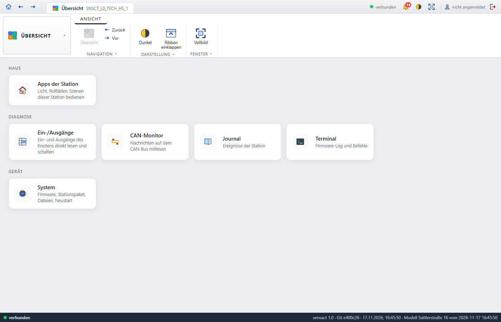
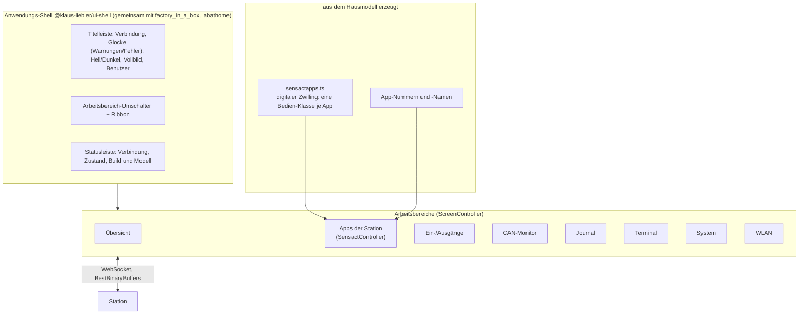
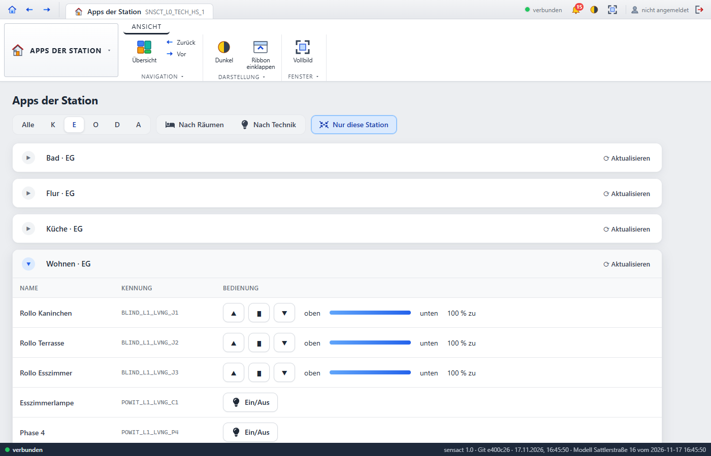

# 7 Weboberfläche

Jede ESP32-Station liefert eine eigene Weboberfläche aus. Sie dient dem Bedienen (Apps schalten), der
Diagnose (Ein-/Ausgänge, CAN, Log) und der Wartung (Paket, Firmware, WLAN).

## Aufbau

| Arbeitsbereich | Gruppe | Wofür |
|---|---|---|
| Übersicht | – | Kacheln aller Arbeitsbereiche, Startseite |
| Apps der Station | Haus | Lampen, Rollläden, Signale bedienen; Status live |
| Fingerabdruck | Haus | nur an der Seitentür: Finger anlernen und verwalten |
| Ein-/Ausgänge | Diagnose | Eingänge der PCA9555 lesen, Ausgänge direkt schalten |
| CAN-Monitor | Diagnose | Nachrichten auf dem CAN-Bus mitlesen |
| Journal | Diagnose | Ereignisse der Station (überstehen Neustarts) |
| Terminal | Diagnose | Firmware-Log mit Filtern und Export, Konsole (`help`, `loglevel`, `restart` …) |
| System | Gerät | Partitionen, Kennwerte, **Stationspaket**, **Firmware-Update**, Neustart |
| WLAN | Gerät | Netze suchen und verbinden (nur Stationen mit WLAN) |

## Der digitale Zwilling

Die Liste der Apps einer Station wird **nicht** zur Laufzeit aus der Konfiguration zusammengesucht,
sondern vom Builder aus dem Hausmodell als TypeScript erzeugt (`sensactapps.ts`) und mit der Oberfläche
ins Stationspaket gepackt. Für jeden App-Typ gibt es eine Bedienklasse
(`npm-packages/@klaus-liebler/web-components-sensact/sensactapps_base.ts`): Rollladen mit Auf/Stopp/Ab
und Positionsbalken, Dimmer mit Schalter und Schieberegler, Schaltausgang mit Ein/Aus usw.

Warum erzeugt statt zur Laufzeit gebaut: Es gibt nur eine Abbildung „Modell → App-Objekte“ (im
Generator), keine zweite in TypeScript, die mit ihr auseinanderlaufen könnte. Weil Oberfläche und
Konfiguration gemeinsam im Paket reisen, passen sie immer zusammen.

Gruppiert wird nach Technik (Typ-Präfix des Namens, angezeigt als „Dimmer“, „Rollläden und Markisen“ …) oder
nach Raum (Raum und Ebene aus dem Namen, angezeigt als „Wohnen · EG“); die Klartexte stehen in
`sensact-base/application_id_utils.ts`. Filter für die Ebenen K (Keller), E (Erdgeschoss), O (Obergeschoss),
D (Dachgeschoss), A (außen). „Nur diese Station“ zeigt nur die Apps dieser Station; ausgeschaltet lassen sich alle Apps des Hauses
schalten (die Kommandos gehen dann über CAN).

## Wartungsseite

Fest in der Firmware steckt nur eine kleine Wartungsseite. Sie wird ausgeliefert, solange kein gültiges
Stationspaket vorhanden ist (Sicherheitsmodus), und bietet Paket-Upload, Firmware-Upload und Log.

## Entwickeln ohne Gerät

`npm run wss` und `npm run dev:testserver` in `firmware/sensact_firmware/web/` starten einen Testserver,
der die Station mit allen Namensräumen nachbildet (inkl. simuliertem Firmware-Log), und den
Vite-Dev-Server unter `https://localhost:5173`. Die Bilder dieser Dokumentation stammen von dort.
Gegen ein echtes Gerät leitet `npm run dev` die WebSocket-Verbindung per Proxy weiter (eigenes Login).
