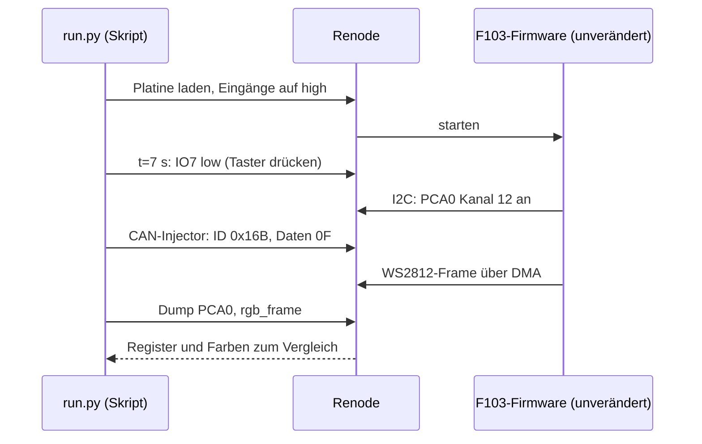

# 8 Qualitätssicherung

Stationen sitzen in Wänden und Verteilern; ein Fehler fällt dort spät und teuer auf. Deshalb wird so viel
wie möglich am PC geprüft – auf vier Ebenen:

## Modellprüfung

Jedes Laden des Hausmodells (Editor, Builder) prüft Schema, Katalog-Regeln und Kommandos und meldet
alle Fehler mit Zeilennummer (s. [Hausmodell](02-hausmodell.md#prüfungen)). Ein fehlerhaftes Modell wird
weder gespeichert noch ausgeliefert.

## Host-Tests der Apps

`espidf-components/sensact-applicationmodel/host_test`: Die Apps werden mit einem PC-Compiler gegen einen
nachgebildeten Kontext (`FakeSensactContext`: Zeit, Ein-/Ausgänge, gesendete Kommandos, LEDs) gebaut und
mit GoogleTest geprüft – ohne Hardware, in wenigen Sekunden.

Abgedeckt sind u. a.:

- Verhalten jeder App (Taster-Flanken, Dimmkurven und Fades, Rollladen-Fahrzeiten und Verriegelung in
  allen sechs Relaismodi, Dämmerungsberechnung, Klingel-Zeitfenster, Signal-Muster),
- das Zusammenspiel mehrerer Apps (Taster → Dimmer → Netzteil),
- die **App-Fabrik**: Für jede ESP32-Station des Test- und des echten Hausmodells legt sie aus der
  binären Konfiguration genau die Apps an, die der Code-Generator erzeugt hätte; beschädigte Daten werden
  abgelehnt.

Der Builder führt die Tests vor jedem `Pipeline`/`PipelineOffline`/`BuildForOta` aus; ein roter Test bricht
den Build ab. Bedienung: [host_test/README.md](../../espidf-components/sensact-applicationmodel/host_test/README.md).

## Editor-Selbsttest

`dotnet run --project editor_tests` prüft die Editor-Logik auf einer Kopie der Modelle: Formular aus dem
XSD, Anlegen, Umbenennen mit Verweisen, Löschen mit Reservierung, unverändertes Speichern.

## Emulatoren

- **rtoos** prüft seine Treiber (auch den F103-Port: GPIO, I2C mit Errata-Recovery, bxCAN, Timer, DMA,
  WS2812) mit Selbsttests in **Renode** und **QEMU**, dazu Host-Tests der Compile-Zeit-Konfiguration.
- **F103-Firmware:** Renode mit einem Modell der sensactUp-Platine (`firmware/sensact_firmware_f103/emulation`):
  zwei PCA9685, ein CAN-Hub mit einem zweiten, scriptbaren Teilnehmer, WS2812 über Timer und DMA.
  Ein Lauf lädt die Stationskonfiguration, drückt Taster, schickt CAN-Kommandos und liest PWM-Register und
  LED-Farben aus – z. B. „IDENTIFY → alle LEDs blau“, „Türklingel-Kommando → Ecken blinken weiß“.

## Erprobung am Gerät

Was nur am Gerät geprüft werden kann – Sichtbarkeit der LEDs durch die Abdeckung, Verhalten bei
gestörtem I2C-Kabel, Ethernet, OTA mit Rollback – steht als offener Punkt mit genauer Prüfanleitung in
[known-issues.md](../../firmware/sensact_firmware/docs/known-issues.md).
