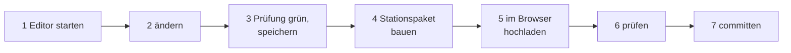
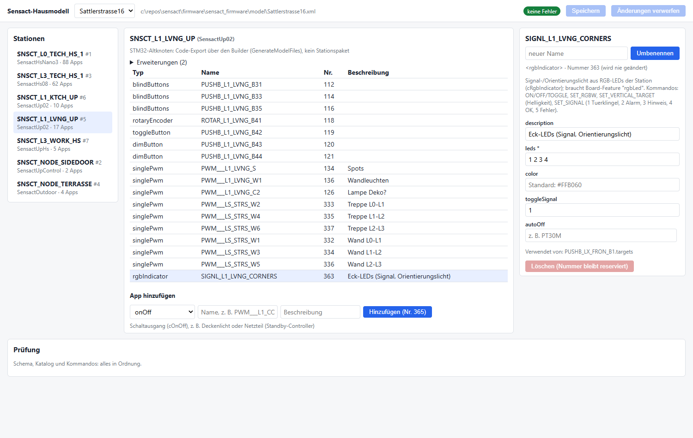
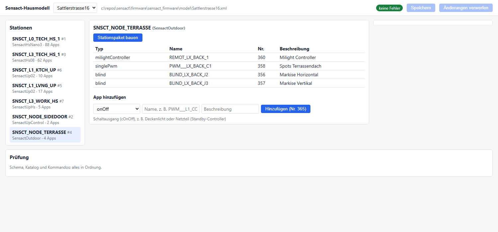
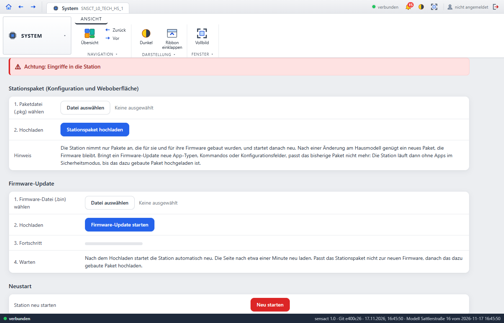

# Betrieb und Änderungen

Für den Betreuer der Anlage: Wie man Taster umbelegt, Geräte ergänzt, Stationen aktualisiert und Störungen
findet. Hintergründe stehen in den [Fachkonzepten](../README.md#fachkonzepte); Einrichtung der
Entwicklungsumgebung in [build-process.md](../../firmware/sensact_firmware/docs/build-process.md).

## Vorbereitung (einmal je PC)

- Checkout von `sensact` und der Nachbar-Repos unter `C:\repos\` ([repo-map.md](../../firmware/sensact_firmware/docs/repo-map.md)).
- .NET-SDK für Editor und Builder; für Firmware-Builds zusätzlich ESP-IDF bzw. GCC 16 (F103).
- Zugriff auf das Board-Archiv (Zertifikate, Kennwörter der Stationen).
- Befehle des Builders aus **PowerShell** ausführen, nicht aus Git-Bash.

## Eine Änderung am Hausmodell

Typische Fälle: ein Taster soll eine andere Lampe schalten, eine Ausschaltzeit ändert sich, eine Lampe
kommt hinzu, eine Signal-Leuchte soll bei der Klingel mitblinken.



1. **Editor starten** – im Ordner `firmware/sensact_firmware`:
   ```
   dotnet run --project editor
   ```
   und `http://localhost:5247` öffnen. Oben das Haus wählen (`Sattlerstrasse16`).

2. **Ändern** – links die Station wählen, in der Mitte die App, rechts das Formular:

   

   - **Ziel ändern:** Feld `targets`/`target` – Vorschläge aus allen Apps des Hauses.
   - **Zeiten:** als Dauer (`PT30M` = 30 Minuten, `PT1H30M`, `PT0S` = nie) oder über die Vorgaben.
   - **Neue App:** unten „App hinzufügen“: Typ wählen, Namen nach dem Schema `TYP__EBENE_RAUM_GERÄT`
     vergeben (z. B. `PWM___L1_KTCH_S3`), Beschreibung; die Nummer vergibt der Editor. Danach Ein-/Ausgang
     und Parameter im Formular setzen.
   - **Umbenennen:** neuen Namen eintragen, „Umbenennen“ – alle Verweise werden mitgezogen.
   - **Löschen:** nur möglich, wenn keine andere App mehr auf diese verweist („Verwendet von“ ist leer);
     die Nummer bleibt reserviert.
   - Stationen und Erweiterungsbausteine werden (noch) direkt in der XML-Datei bearbeitet, s.
     [model/README.md](../../firmware/sensact_firmware/model/README.md).

3. **Prüfen und speichern** – der Kasten „Prüfung“ unten muss „alles in Ordnung“ melden, oben steht dann
   „keine Fehler“. Erst dann ist **Speichern** möglich. Typische Meldungen und was sie bedeuten:

   | Meldung | Ursache |
   |---|---|
   | Eingang „IN0.13“ ist schon von … belegt | zwei Apps am selben Eingang |
   | braucht das Board-Feature … | App-Typ passt nicht zur Platine (z. B. Drehgeber auf einer Station ohne Drehgeber) |
   | Ziel … versteht das Kommando … nicht | z. B. Rollladentaster auf eine Lampe gerichtet |

4. **Stationspaket bauen** – bei einer ESP32-Station (Technik, Arbeitszimmer, Seitentür, Terrasse) den
   Knopf **Stationspaket bauen**; das Protokoll läuft live mit, danach die Datei `<Station>.pkg`
   herunterladen:

   

   Betrifft die Änderung mehrere Stationen (z. B. ein Taster im Keller schaltet nun ein Signal im
   Wohnzimmer), bekommt **jede betroffene Station** ein neues Paket – auch die, auf der sich nur der
   Sender geändert hat. Im Zweifel alle ESP32-Stationen neu packen; es schadet nicht.

   Ohne Editor, auf der Kommandozeile:
   ```
   dotnet run --project builder -- BuildPackageFor --nodeId SNSCT_L0_TECH_HS_1 --model Sattlerstrasse16
   ```

5. **Hochladen** – Weboberfläche der Station → **System** → *Stationspaket* → Datei auswählen →
   *Stationspaket hochladen*. Die Station prüft das Paket, startet neu und arbeitet mit der neuen
   Konfiguration; die Seite lädt sich selbst neu.

   

6. **Prüfen** – im Arbeitsbereich *Terminal* nach dem Neustart die Zeile
   `Station configuration loaded: <Station>, <n> apps` suchen; das Gerät über *Apps der Station* oder den
   Taster schalten.

7. **Committen** – die geänderte `Sattlerstrasse16.xml` ins Git. Das Modell im Repo ist die Wahrheit;
   wer später ein Paket baut, baut es von dort.

### Änderung an einer Bedienstelle im Wohnzimmer oder in der Küche (STM32F103)

Diese Stationen haben kein Netzwerk; ihre Konfiguration steckt in der Firmware.

```
cd firmware/sensact_firmware
dotnet run --project builder -- GenerateStm32F103Files --model Sattlerstrasse16 --nodeId SNSCT_L1_LVNG_UP
cd ../sensact_firmware_f103
cmake --preset lvng
cmake --build --preset lvng
```

(Küche: `--nodeId SNSCT_L1_KTCH_UP`, Preset `ktch`.) Dann mit ST-Link über den SWD-Stecker flashen,
beim ersten Mal im Reset-Modus (Taster SW2 halten) – Befehle in
[sensact_firmware_f103/README.md](../../firmware/sensact_firmware_f103/README.md#flashen).
Nach dem Start blinkt die Status-LED kurz einmal je Sekunde; 5 Hz heißt „keine gültige Konfiguration“.

## Firmware einer ESP32-Station aktualisieren

Nötig, wenn sich der Code geändert hat (Fehlerbehebung, neuer App-Typ, neues Kommando).

1. Station als aktives Board wählen (sie muss einmal per USB angeschlossen gewesen sein):
   ```
   dotnet run --project builder -- SelectBoard --nodeId SNSCT_L0_TECH_HS_1
   ```
2. Firmware und Paket bauen (führt vorher die Tests aus):
   ```
   dotnet run --project builder -- BuildForOta --model Sattlerstrasse16
   ```
   Ergebnis in `deploy/SNSCT_L0_TECH_HS_1/`: `sensact_firmware.bin`, `SNSCT_L0_TECH_HS_1.pkg`, `README.txt`.
3. Weboberfläche → **System** → *Firmware-Update*: Datei auswählen → *Firmware-Update starten*, Neustart abwarten.
4. Passt das bisherige Paket nicht mehr zur neuen Firmware, zeigt die Station die **Wartungsseite**
   (Sicherheitsmodus, Geräte außer Betrieb). Dort das neue Paket hochladen.

Hat das Update einen neuen App-Typ oder ein neues Kommando gebracht, brauchen **alle** ESP32-Stationen die
neue Firmware und neue Pakete, und die F103-Stationen eine neu gebaute Firmware.

## Eine neue Station in Betrieb nehmen

1. Station im Hausmodell anlegen – in der XML-Datei, **hinten** anfügen, mit neuer Stationsnummer und dem
   Board-Typ aus `model/catalog.xml`; Erweiterungsbausteine (`<extension>`) mit Bus und Adresse eintragen.
2. Apps im Editor ergänzen.
3. Gerät per USB anschließen, im Board-Archiv `sensact.json` mit dem Stationsnamen anlegen
   ([board-provisioning.md](../../firmware/sensact_firmware/docs/board-provisioning.md)).
4. Alles bauen und flashen:
   ```
   dotnet run --project builder -- Pipeline --model Sattlerstrasse16
   ```
   Die Station startet gleich mit Konfiguration und Weboberfläche.
5. WLAN einrichten (falls nötig) über den eigenen Zugangspunkt der Station, dann im Hausnetz prüfen.

Ein **neuer Board-Typ** braucht zusätzlich Code (Board-Initialisierung) und einen Katalogeintrag –
Entwicklersache, s. [board-provisioning.md](../../firmware/sensact_firmware/docs/board-provisioning.md).

## Störungen finden

| Symptom | Wo schauen | Mögliche Ursache |
|---|---|---|
| Weboberfläche zeigt die Wartungsseite | Terminal/Log: „SAFE MODE“ mit Grund | Paket fehlt, gehört zu einer anderen Station oder passt nicht zur Firmware → passendes Paket hochladen |
| Upload des Pakets abgelehnt | Meldung im Browser | falsche Station oder Paket für eine andere Firmware gebaut → für diese Station mit dem aktuellen Stand neu bauen |
| Lampen an einer Erweiterung reagieren nicht | Terminal: Meldungen von `I2C`; *Ein-/Ausgänge* | Baustein antwortet nicht (Kabel, Adresse, Versorgung) |
| F103-Bedienstelle: LED am Knopf blinkt zweimal rot | Konsole der Station (USART 115200 Baud): Zähler `recover`, `reinits`, CAN-Fehler | gestörtes I2C-Kabel zu den PCA9685 oder CAN-Problem |
| Befehle über den Bus kommen nicht an | *CAN-Monitor* auf zwei Stationen vergleichen | CAN-Leitung, Abschluss, Station ohne Strom |
| Taster löst nichts aus | *Ein-/Ausgänge*: ändert sich der Eingang beim Drücken? | Verdrahtung, falscher Eingang im Modell, Taster klemmt |
| Zeitgesteuerte Rollläden fahren nicht | System: Uhrzeit gestellt? App aktiv? | keine Zeit vom Netz (SNTP) oder Automatik ausgeschaltet |
| Glocke in der Titelleiste zählt hoch | Terminal mit Filter „Fehler“/„Warnungen“ | Log-Datei speichern und auswerten |

Für Rückfragen an Entwickler: im Terminal **Speichern** (Log-Export) und das Journal ansehen.

## Sicherung

- **Hausmodell:** liegt im Git-Repo `sensact` – nach jeder Änderung committen und pushen.
- **Board-Archiv** (Kennwörter, Zertifikate, Zuordnung Gerät ↔ Station): liegt außerhalb des Repos und
  muss gesichert sein; ohne es lassen sich Stationen nicht mehr mit ihren Zertifikaten bauen.
- **Stationspakete und Firmware** sind jederzeit aus Modell und Code neu erzeugbar.

## Bekannte offene Punkte

Was noch nicht am Gerät erprobt ist oder aussteht, steht in
[known-issues.md](../../firmware/sensact_firmware/docs/known-issues.md) – vor größeren Änderungen
einen Blick hineinwerfen.
