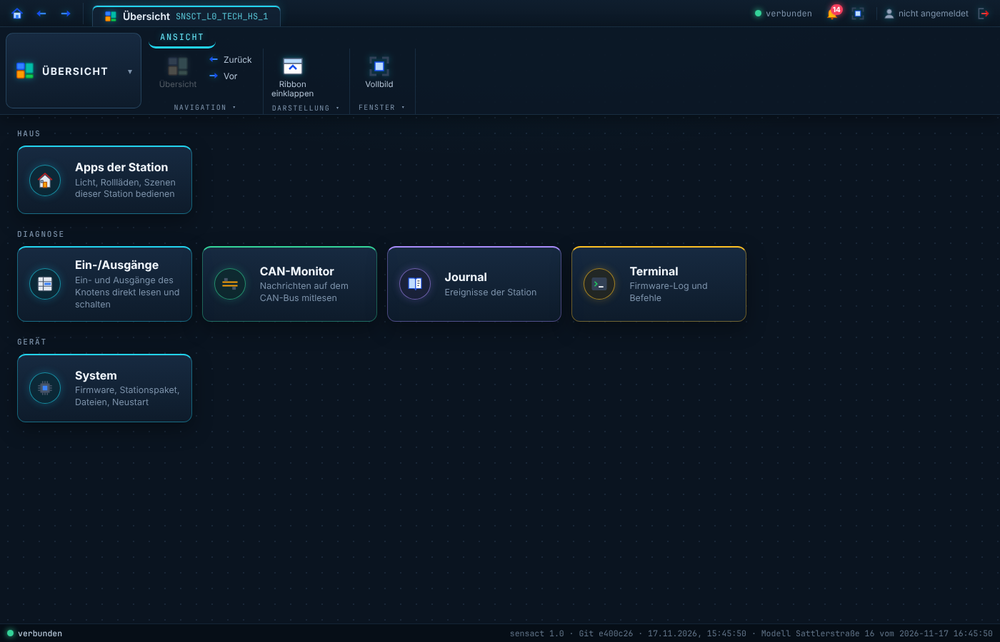
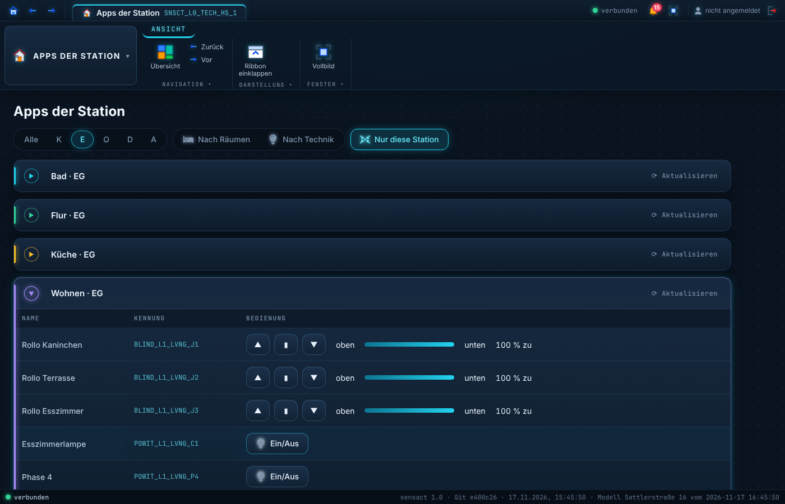
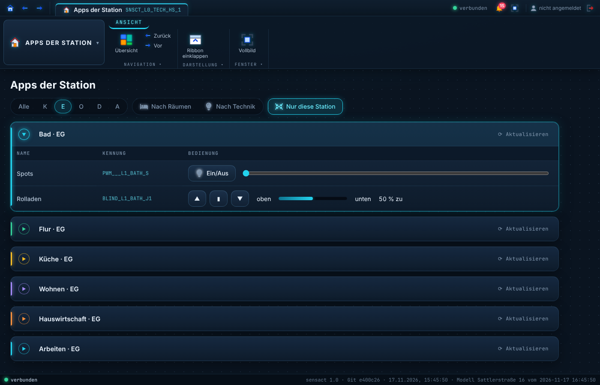
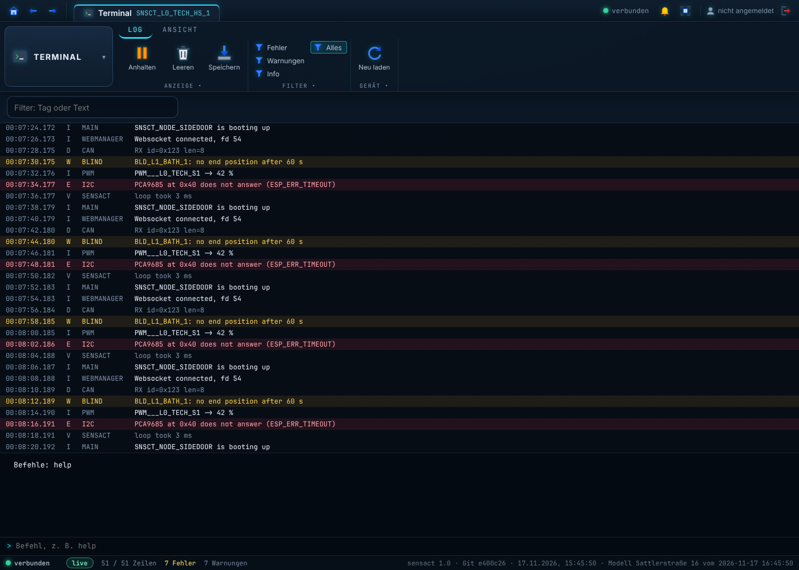
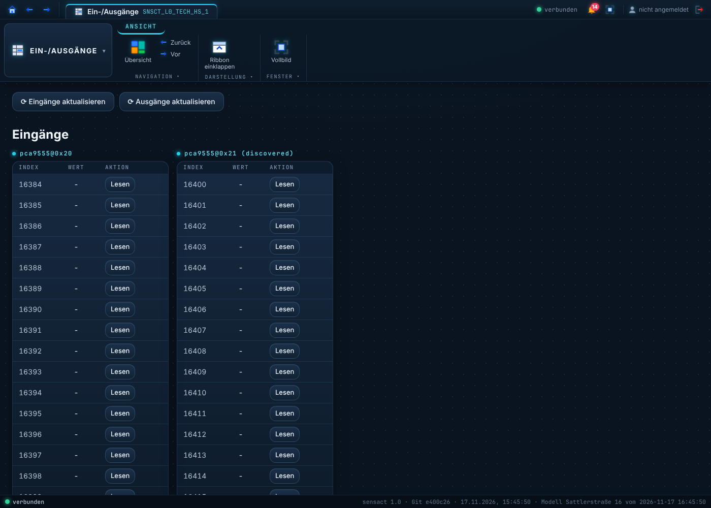
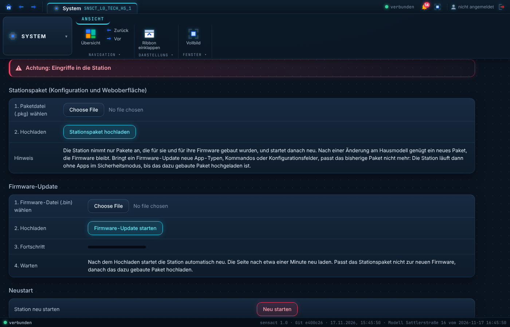

# Weboberfläche

Jede Station mit Netzwerkanschluss (Technik im Keller, Arbeitszimmer, Seitentür, Terrasse) hat eine
eigene Weboberfläche im Browser – am PC, Tablet oder Handy im Hausnetz.

## Verbinden und anmelden

1. Im Browser `https://<Stationsname>/` öffnen, z. B. die Technikstation im Keller unter ihrem Namen
   `SNSCT_L0_TECH_HS_1` bzw. der IP-Adresse, die der Router ihr zugeteilt hat.
2. Ist das Stammzertifikat der Anlage im Browser nicht installiert, warnt der Browser vor dem
   Zertifikat. Das Stammzertifikat bekommt man vom Betreuer; einmal installiert, verschwindet die Warnung.
3. Mit Benutzername und Kennwort der Station anmelden (vom Betreuer).

Abmelden über das Symbol ganz rechts in der Titelleiste.

## Die Startseite

- **Titelleiste:** Name der Station, Verbindungsanzeige („verbunden“), Glocke mit der Zahl neuer
  Warnungen und Fehler, Vollbild, angemeldeter Benutzer. Die Oberfläche ist immer dunkel
  (Leitwarten-Look), eine Hell/Dunkel-Umschaltung gibt es deshalb nicht.
- **Kacheln:** die Arbeitsbereiche dieser Station, gruppiert in *Haus*, *Diagnose* und *Gerät*. Ein Klick
  öffnet den Bereich; oben links wechselt man zwischen den Bereichen, „Übersicht“ führt zurück.
- **Statusleiste** unten: Verbindung, Firmware-Version und Stand des Hausmodells.

## Licht und Rollläden bedienen – „Apps der Station“

- Die Geräte erscheinen in aufklappbaren Gruppen. **Nach Räumen** gruppiert nach Räumen
  (z. B. „Wohnen · EG“), **Nach Technik** nach Art (Rollläden und Markisen, Schaltausgänge, Dimmer …).
- Die Knöpfe daneben filtern nach Etage: **Alle**, **K** Keller, **E** Erdgeschoss, **O** Obergeschoss,
  **D** Dachgeschoss, **A** außen.
- **Nur diese Station** (leuchtet cyan = an) zeigt nur die Geräte, die an *dieser* Station angeschlossen sind. Aus
  geschaltet erscheinen alle Geräte des Hauses; auch die lassen sich schalten.
- **Aktualisieren** holt den aktuellen Zustand der Gruppe; Änderungen erscheinen sonst von
  selbst.

Bedienelemente:

| Gerät | Bedienung |
|---|---|
| Rollladen | ▲ auf, ■ Stopp, ▼ ab (wie ein kurzer Tastendruck); Balken und Prozentzahl zeigen, wie weit er geschlossen ist (100 % = ganz zu, 0 % = ganz offen) |
| Lampe | **Ein/Aus** schaltet um |
| Dimmer | **Ein/Aus** schaltet um, der Schieberegler stellt die Helligkeit |

## Diagnose

### Terminal

Zeigt die Meldungen der Station seit dem Start und live: Zeit, Stufe (E Fehler, W Warnung, I Info,
D/V Details), Herkunft und Text. Fehler sind rot, Warnungen gelb hinterlegt.

- Im Ribbon: **Anhalten** (Anzeige einfrieren), **Leeren**, **Speichern** (als Datei für den Betreuer),
  Filter nach Fehlern/Warnungen/Info, **Neu laden**.
- Das Feld „Filter“ sucht nach Text oder Herkunft (z. B. `I2C`, `CAN`, einem Gerätenamen).
- Unten eine Befehlszeile: `help` listet die Befehle, z. B. `loglevel * debug` für mehr Details oder
  `restart`.

### Weitere Bereiche

| Bereich | Wofür |
|---|---|
| **Ein-/Ausgänge** | Eingänge der Erweiterungsbausteine lesen und Ausgänge direkt schalten – für die Fehlersuche an der Verdrahtung |
| **CAN-Monitor** | zeigt, was über die Verbindung zwischen den Stationen läuft |
| **Journal** | wichtige Ereignisse der Station; bleibt auch nach einem Neustart erhalten |

## Gerät

### System

Kennwerte der Station (Uhrzeit, Laufzeit, freier Speicher, Firmware-Partitionen) und unter
**Achtung: Eingriffe in die Station**:

- **Stationspaket:** neues Stationspaket hochladen (Datei auswählen → *Stationspaket hochladen*). Die Station
  prüft das Paket, startet neu und die Seite lädt sich danach selbst neu.
- **Firmware-Update:** neue Firmware hochladen (Datei auswählen → *Firmware-Update starten*). Die Station startet danach neu; die Seite
  nach etwa einer Minute neu laden.
- **Neustart:** Station neu starten.

Diese Funktionen sind für den Betreuer gedacht; die Abläufe stehen in
[Betrieb und Änderungen](betrieb-und-aenderungen.md).

### WLAN

Netze suchen und verbinden (nur Stationen, die über WLAN angebunden sind). Findet die Station ihr Netz
nicht, öffnet sie nach einiger Zeit einen eigenen Zugangspunkt mit ihrem Namen, über den man sie neu
einrichten kann.

## Wartungsseite

Erscheint statt der normalen Oberfläche eine schlichte **Wartungsseite**, fehlt der Station ein gültiges
Stationspaket (z. B. nach einem Firmware-Update). Die Geräte dieser Station sind dann außer Betrieb. Über
die Wartungsseite lädt der Betreuer das passende Paket hoch.
